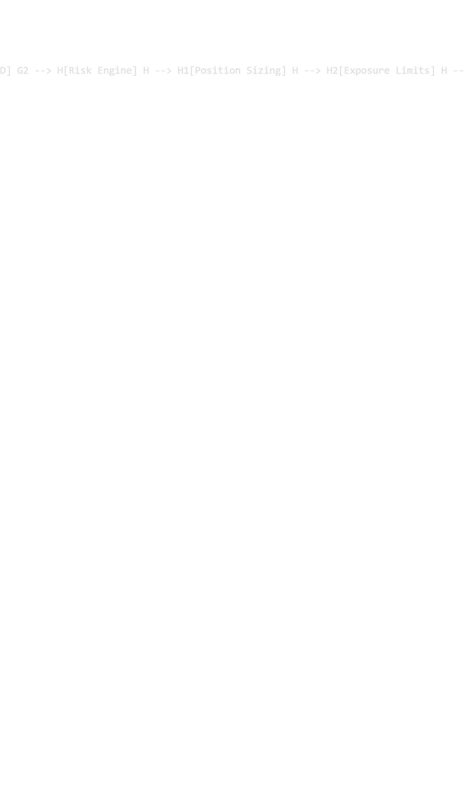

# Trading-Bot
A modular algorithmic trading system built with Python, Polars, and the Alpaca API.

Features:
Market data ingestion
Data validation
Technical indicators
Strategy engine
Risk Management
Order execution

