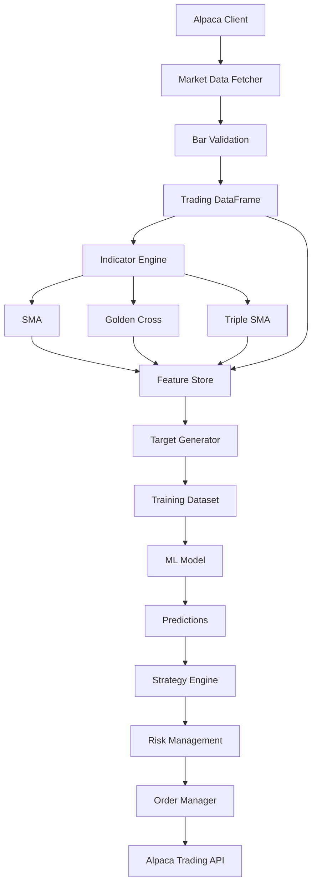

# Trading-Bot
A modular algorithmic trading system built with Python, Polars, and the Alpaca API.

Features:
Market data ingestion
Data validation
Technical indicators
Strategy engine
Risk Management
Order execution





## Running the tests

```bash
cd "trade bot"
pip install -r requirements-dev.txt
pytest
```

Known bugs are covered by tests marked `xfail` with the reason. To list them, run
`pytest -rx`. `xfail_strict` is on, so when a bug is fixed its test reports `XPASS`
and fails the run until the marker is removed.
